# deej-tab

物理スライダーで、Windows / Mac のアプリごとの音量と **ブラウザ（Chrome・Edge など）のタブごとの音量** を操作する自作ミキサーです。
[deej](https://github.com/omriharel/deej) を元に、PC アプリ・ブラウザの拡張機能・LED 付きファームウェア・3D プリント用ケース（[MakerWorld](https://makerworld.com/models/3382344)）までまとめてあります。

<p align="center">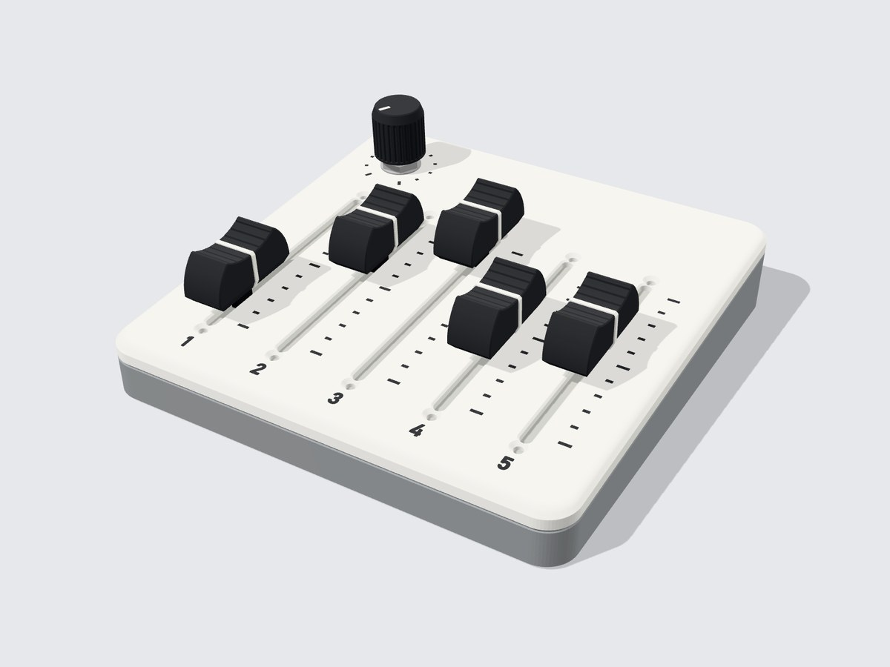</p>
<p align="center"><sub>完成イメージ（3D レンダリング）。スライダー 5 本・ノブ 1 つ、外形 126×126mm</sub></p>

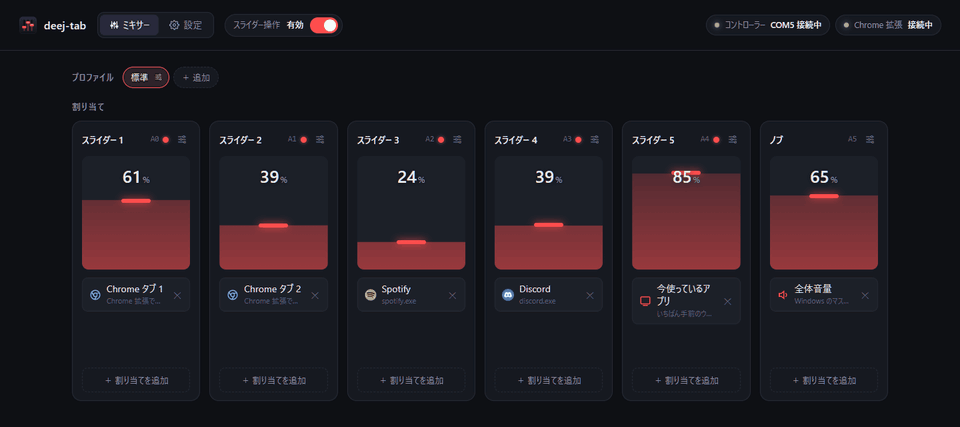

- [できること](#できること) / [必要なもの](#必要なもの) / [セットアップ](#セットアップ) / [使い方](#使い方) / [Mac 版について](#mac-版について) / [仕組み](#仕組み) / [開発](#開発)

## できること

- スライダー 5 本＋ノブ 1 つに、全体音量・マイク・アプリ（Discord・Spotify など）・**Chrome のタブ**・今使っているアプリ・ゲーム・OBS の音声ソースを割り当てる
- Chrome で開いた配信や動画を、タブごとに別のスライダーで調整（Alt+Shift+A でタブを割り当て）
- 日本語・英語の画面（English UI）
- 設定画面で割り当て・スライダーごとの最大音量（100% 超えも可。タブ・OBS のみ）・音量の変わり方を変更
- プロファイル（割り当て一式）の切り替え。アプリが前に来たら自動で切り替えも可
- 一時停止（ショートカットも可）。止めるとアプリの音量を元に戻す（全体の音量はそのまま）
- スライダーの LED で状態や音の大きさを表示。光り方は設定画面で選べる
- config.yaml は deej と互換

## 必要なもの

### PC

- Windows 10 / 11、または macOS 14.2 以降の Apple シリコン（M1 以降）の Mac（Mac は [Mac 版について](#mac-版について) を参照）
- Chrome・Edge・Brave など Chromium のブラウザ（Chrome 116 相当以降。タブの音量を操作する場合）

### 部品

| 部品 | 例 | 数 |
|---|---|---|
| マイコン | Arduino Nano 互換ボード（USB Type-C 版。ケースは Mini-USB の Nano には合いません） | 1 |
| スライダー | Bourns PTL60-15R0-103B2（60mm・10kΩ B カーブ・赤 LED 付き） | 5 |
| 回転ボリューム | 16mm 型 10kΩ B カーブ（SH16K4B103L20KCCI など。6mm ローレット軸 18 山・軸長 20mm・M7 取付ネジ・回り止め付き） | 1 |
| ノブ | 3D プリント（[MakerWorld](https://makerworld.com/models/3382344) のデータ）または市販の 6mm 軸用（ABS-28 など） | 1 |
| LED 用抵抗 | 180Ω〜1kΩ（1/4W・1/6W など。例：330Ω） | 5 |
| M2 皿ネジ | M2×4 程度（ケースにスライダーを固定。1 本につき 2 本） | 10 |

LED 用抵抗：スライダーの赤色 LED はデータシートで順方向電流 20mA・順方向電圧 1.8V（標準）と規定されているので、5V で 20mA 以下にするには (5V − 1.8V) ÷ 20mA ≒ 160Ω 以上が必要です。値が小さいほど明るくなります（330Ω で約 10mA）。

LED なしのスライダーでも動きます（LED の機能が使えないだけです）。

### 配線

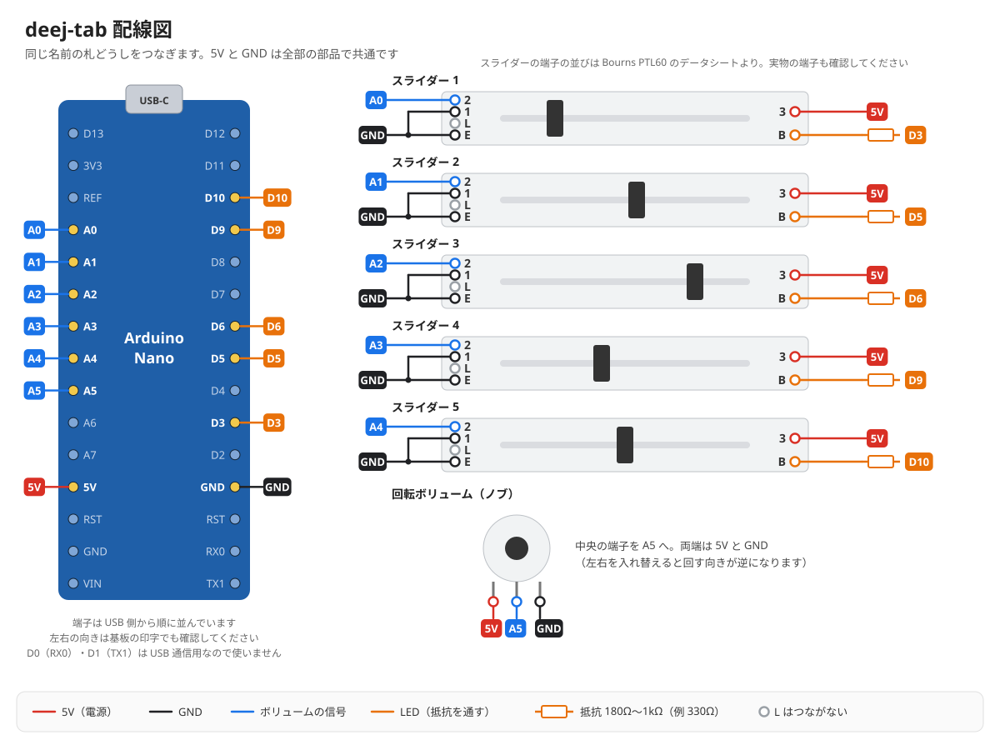

同じ名前の札どうしをつなぎます。5V と GND は全部の部品で共通なので、まとめて Nano の 5V・GND へつなぎます。

| 部品 | 端子 | つなぐ先 |
|---|---|---|
| スライダー 1〜5 | 1 | GND |
| | 3 | 5V |
| | 2（ワイパー） | A0〜A4 |
| | B（LED＋） | 抵抗 → D3 / D5 / D6 / D9 / D10 |
| | E（LED−） | GND |
| | L | つながない |
| 回転ボリューム | 両端 | 5V / GND |
| | 中央 | A5 |

D0 / D1 は USB シリアルに使うので空けておきます。

**基板版**：スライダー 5 本とノブを 1 枚の基板に載せ、Nano とはケーブル 3 本でつなぐ版も用意しています。配線が楽になります。基板を発注・組み立てて、6ch の値と LED が動くことを確かめてあります。ガーバーは [Releases](../../releases) の `pcb-v0.1.0`、部品・組み立て・注文のしかたは [pcb/README.md](pcb/README.md) にあります。

## セットアップ

[Releases](../../releases) から最新版をダウンロードします。

### 1. PC アプリを入れる

1. `deej-tab-x.y.z-setup.exe` を実行する
   - 「Windows によって PC が保護されました」と出たら、「詳細情報」→「実行」を押します（コード署名をしていない個人の配布物なので出ます）
   - 管理者の許可は要りません。`%LOCALAPPDATA%\Programs\deej-tab` に入り、スタートメニューに deej-tab が出ます
   - 「Windows の起動時に自動で起動する」は初期設定でオンです（あとからタスクトレイのメニューでも切り替えられます）
2. 終わると deej-tab が起動して、設定画面が開きます。ファームウェアを書き込んだコントローラーを USB につなぐと、自動で見つけてつながります（まだ書き込んでいない Nano は、次の「2. コントローラーにファームウェアを書き込む」へ）
   - 見つからないときは、設定画面の上に「コントローラーが見つかりません」と出て、確かめることを案内します。互換品の Nano は CH340 のドライバが要ることがあります（お知らせの「ドライバのページを開く」から入れられます）
   - それでもつながらないときは、設定画面の「設定」→「コントローラー」で COM ポートを選びます
   - タスクトレイのアイコンは、画面右下の「^」の中に隠れていることがあります

- **更新**：新しい版の `setup.exe` を実行するだけです。動いている deej-tab は自動で終了し、設定はそのまま残ります
- **アンインストール**：Windows の「設定」→「アプリ」から。設定ファイル（config.yaml）とログは消さずに残します
- **インストールせずに使う**：`deej-tab-x.y.z-windows.zip` を展開して `deej-tab.exe` を起動します（設定ファイルとログは exe の隣に作られます）。zip 版からインストーラー版に移るときは、deej-tab を終了してから、zip 版の `config.yaml` を `%LOCALAPPDATA%\Programs\deej-tab` にコピーすると設定を引き継げます

Mac の場合は [Mac 版について](#mac-版について) を見てください。

### 2. コントローラーにファームウェアを書き込む

deej-tab の設定画面から書き込めます（Arduino IDE は要りません）。

1. Nano を USB でつなぐ
2. 設定画面の「設定」→「コントローラー」の「接続先」で、Nano のポートを選ぶ（初めての Nano は「コントローラーが見つかりません」と出ますが、そのままで大丈夫です）
3. 「ファームウェア」の「書き込む」を押す。10〜20 秒で終わり、そのままつながります
   - 新しいブートローダーの Nano も、互換品に多い古いブートローダー（Old Bootloader）の Nano も、自動で見分けます
   - 書き込み直しても、LED の光り方・スライダーの端の位置・コントローラーの ID は残ります
   - deej-tab に新しい版のファームウェアが入ると、「ファームウェア」の行に「新しい版を書き込めます」と出ます
   - ポートが一覧に出ないときは、CH340 のドライバを入れます（「コントローラーが見つかりません」のお知らせからドライバのページを開けます）

<details>
<summary>Arduino IDE で書き込む場合</summary>

1. `deej-tab-firmware-x.y.z.zip` を展開する
2. [Arduino IDE](https://www.arduino.cc/en/software) で `firmware/deej-6ch-led/deej-6ch-led.ino` を開く
3. ボード「Arduino Nano」、ポートを選んで書き込む
   - 互換品で失敗する場合は、プロセッサを「ATmega328P (Old Bootloader)」にする
   - deej-tab が起動中だと書き込めません（トレイから終了してから）

</details>

### 3. ブラウザの拡張機能を入れる

Chrome・Edge・Brave・Vivaldi など、Chrome と同じ仕組み（Chromium）のブラウザで使えます。Firefox と Safari には対応していません。

1. 拡張機能のフォルダを用意する
   - インストーラーで入れた場合：`%LOCALAPPDATA%\Programs\deej-tab\extension`（インストールの完了画面の「ブラウザの拡張機能のフォルダを開く」で開けます）
   - zip の場合：`deej-tab-extension-x.y.z.zip` を展開する（展開したフォルダは消さずに残しておく）
2. ブラウザで `chrome://extensions`（Edge は `edge://extensions`）を開き、「デベロッパー モード」をオンにする（Chrome は右上、Edge は左のメニュー）
3. 「パッケージ化されていない拡張機能を読み込む」で、1 のフォルダを選ぶ

- 拡張機能は 1 つのブラウザにだけ入れてください（2 つのブラウザに入れると、タブの番号がぶつかります）
- **更新**：インストーラー版は `setup.exe` でフォルダの中身が置き換わります。zip 版は新しい版でフォルダの中身を置き換えます。どちらも、そのあと拡張機能のページで「再読み込み」（↻）を押します

### 4. ケースを印刷する（任意）

ケース・ツマミの 3D データは MakerWorld で配布しています。印刷設定と組み立て方もそちらにあります。

| 分解図 | スライダーのツマミ | 上から |
|---|---|---|
| 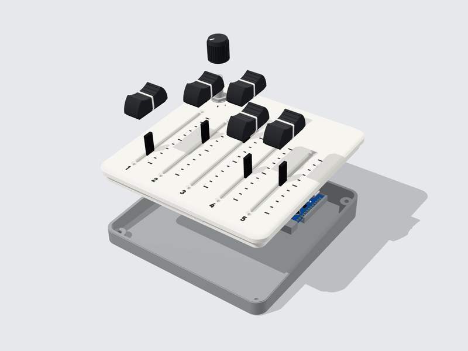 | 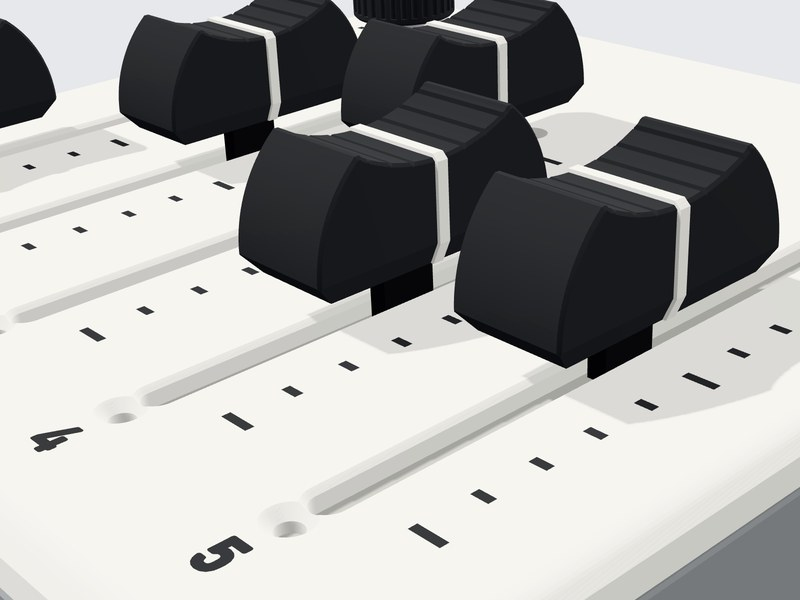 | 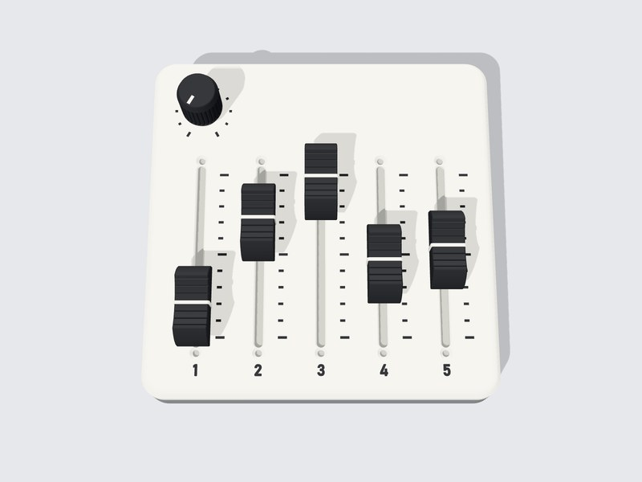 |
| 天板・底ケース・Arduino Nano 固定クリップの 3 部品＋ツマミ | 黒い外殻と白い芯の 2 色。LED の光で白い線が光ります | 目盛りと番号は彫り。塗料を流し込んで色を付けます |

**MakerWorld：** [deej-tab Volume Mixer (5 faders + knob, LED)](https://makerworld.com/models/3382344)

寸法を変えたいときは `case/case.py` の先頭の設定を書き換えて作り直せます（[開発ガイド](docs/dev/README.md#ケースを作る)）。

## 使い方

deej-tab はタスクトレイに常駐します。アイコンをクリックすると設定画面が開きます。右クリックのメニューからは、一時停止・プロファイルの切り替え・自動起動のオン／オフ・終了ができます。

### ミキサー：スライダーに割り当てる

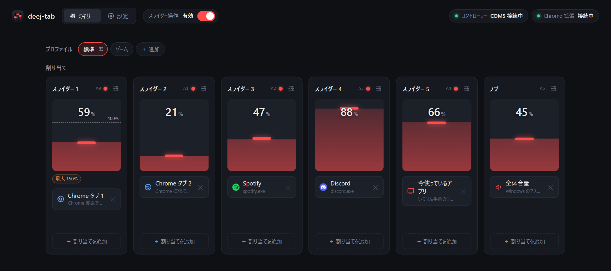

スライダー 1〜5 とノブのそれぞれに、操作したい音量を割り当てます。各スライダーの「＋ 割り当てを追加」から選び、1 本に複数を割り当てることもできます。メーターの塗りが今の音量、赤いつまみがスライダーの位置です。

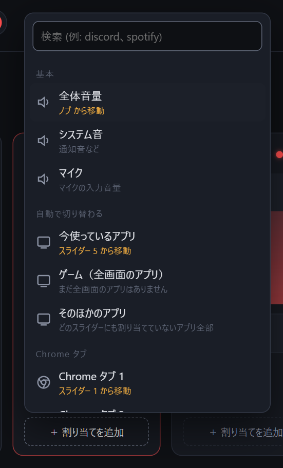

選べるもの：

| 種類 | 内容 |
|---|---|
| 全体音量・システム音・マイク | Windows の音量 |
| 今使っているアプリ | いちばん手前のウィンドウのアプリ（ゲーム中ならゲーム） |
| ゲーム（全画面のアプリ） | 最後に全画面だったアプリ。ほかのウィンドウが前に来ても操作し続けます |
| そのほかのアプリ | どのスライダーにも割り当てていないアプリ全部 |
| Chrome タブ 1〜6 | 拡張機能で番号を付けたタブ（[下](#chrome-のタブの音量を操作する)） |
| アプリ | 音を出しているアプリ・起動中のアプリ・インストール済みのアプリから選べます。検索もできます |
| OBS の音声ソース | OBS 連携をオンにすると出ます |

同じ割り当て先は 1 本のスライダーにしか置けません（ほかのスライダーにあれば移動します）。

<br clear="right">

### スライダーごとの設定

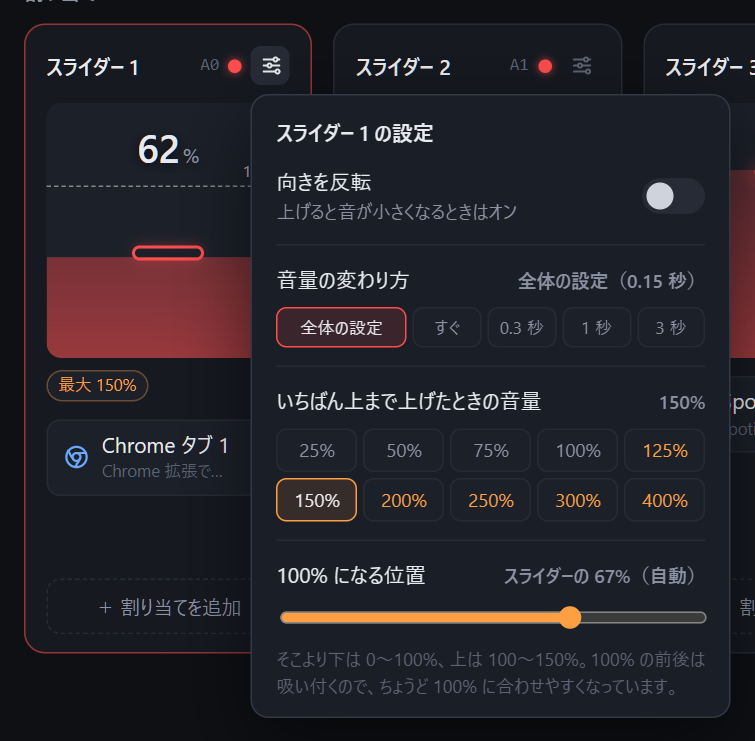

各スライダーの右上のアイコンから、そのスライダーだけの設定を変えられます。

- **向きを反転**：上げると音が小さくなるときに
- **音量の変わり方**：スライダーを速く動かしたとき、音量がどのくらいかけて追いつくか
- **いちばん上まで上げたときの音量**：25〜400%。100% を超える分は Chrome のタブと OBS だけに効きます（Windows の音量は 100% が上限）
- **100% になる位置**：スライダーのどこで 100% になるか

<br clear="right">

### Chrome のタブの音量を操作する

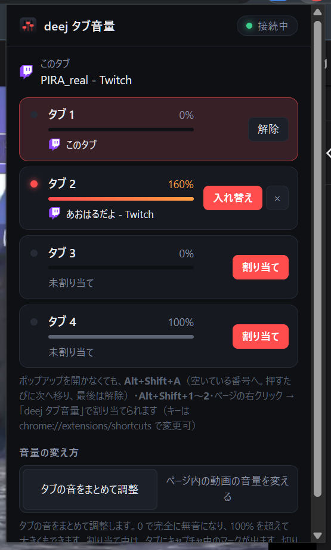

1. 設定画面で、スライダーに「Chrome タブ 1」などを割り当てます
2. 音量を変えたいタブを開いて、**Alt+Shift+A** を押します。空いている番号に割り当てられ、ツールバーのアイコンに番号が出ます
   - もう一度押すと次の番号へ移り、最後は解除されます
   - **Alt+Shift+1・2** で番号を指定、ページの右クリック →「deej タブ音量」からも割り当て・解除できます（キーは `chrome://extensions/shortcuts` で変更できます）
3. 拡張機能のアイコン（**Alt+Shift+D**）を押すと、割り当ての一覧と今の音量が見られます。ほかのタブに割り当て済みの番号は、ここから入れ替えたり解除したりできます
4. ポップアップの「音が鳴ったタブを自動で割り当てる」をオンにすると、動画などの音が鳴り始めたタブが空いている番号に自動で割り当てられます（ポップアップでは番号の横に「自動」と出ます）。自動で割り当てたタブは「ページ内の動画の音量を変える」方式で調整します

ポップアップでは、番号ごとの今の音量（100% を超えるとオレンジ）と、割り当てたタブが見られます。

<br clear="right">

タブの音量は「Chrome のアプリ音量 × 全体音量」に対する割合です。音量の変え方は 2 種類あり、ポップアップで切り替えられます。

| 方式 | 内容 |
|---|---|
| タブの音をまとめて調整（初期設定） | タブの音声をキャプチャして音量をかけます。0 でしっかり無音になり、100% を超える音量にもできます |
| ページ内の動画の音量を変える | ページの動画・音声の音量を直接変えます。サイトによっては 0 でもかすかに聞こえます |

### プロファイル

割り当て一式に名前を付けて保存し、切り替えられます（ミキサーの上の「プロファイル」）。プロファイルごとに次のことができます。

- **自動で切り替え**：指定したアプリが前に来たら、そのプロファイルに切り替えます。アプリを終了すると元に戻ります
- **切り替えのショートカット**：キーを押して切り替えます

切り替えた直後は、スライダーが今の音量の位置を通るまで音量を変えません（音量が飛ばないように。設定でオフにできます）。

### 一時停止

設定画面の上の「スライダー操作」スイッチ、タスクトレイのメニュー、ショートカットで一時停止できます。一時停止中はスライダーを動かしても音量が変わりません。止めたときに、アプリ・マイク・OBS の音量を deej-tab が変える前に戻すこともできます（全体の音量は急に大きくならないよう、止めた時のまま）。

### 設定

設定画面の「設定」ページでは、次のものを変えられます。

- **言語**：自動（Windows の表示言語に合わせる）／日本語／English。タスクトレイのメニューと Chrome 拡張機能のポップアップ・右クリックメニューも切り替わります
- **コントローラー**：つなぐ COM ポート、全スライダーの向き、揺れの抑え、LED で知らせること、自動起動
- **LED の光り方**：操作していないとき・起動したとき・操作したときの光り方と明るさ。プレビューで確かめながら選べ、コントローラーに保存されるので PC から外しても同じ光り方になります
- **動作**：音量の変わり方、一時停止したら元に戻す、プロファイル切り替え時に音量を飛ばさない、一時停止のショートカット
- **OBS 連携**：obs-websocket で OBS の音声ソースを操作

<p align="center">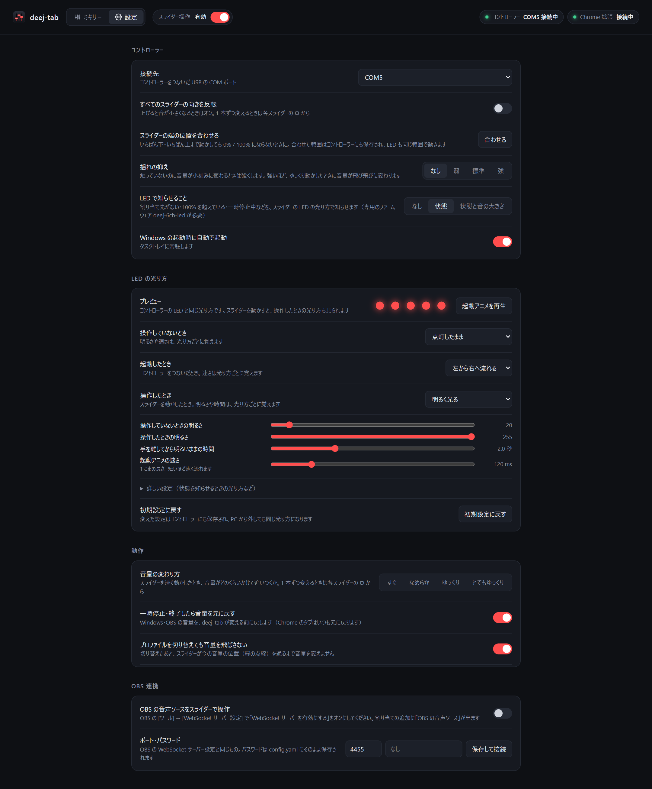</p>

#### スライダーの端の位置を合わせる

いちばん下・いちばん上まで動かしても 0% / 100% にならないときは、「コントローラー」→「スライダーの端の位置を合わせる」で各スライダーを端まで動かします。

<p align="center">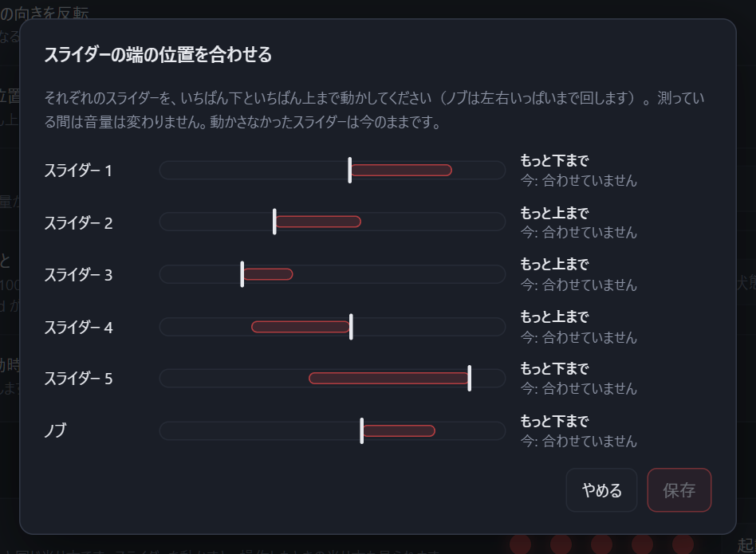</p>

設定は `deej-tab.exe` の隣の `config.yaml` に保存されます。手で書き換えても、保存すると自動で読み直します（形式は deej と互換）。

## Mac 版について

Apple シリコン（M1 以降）の Mac 用です。Intel の Mac では動きません。

### 入れ方

1. `deej-tab-x.y.z-mac.dmg` を開き、`deej-tab.app` を隣の「Applications」へドラッグする
   - dmg の中から直接起動しないでください（取り出すと消えてしまいます）。入れ終わったら、Finder のサイドバーの ⏏ で dmg を取り出します
   - 更新のときも同じです（「置き換える」を選びます）。先にメニューバーのアイコンから deej-tab を終了しておきます
2. 初回は次の手順で起動する（Apple の公証を受けていないため、ダブルクリックだけでは開けません）
   - **macOS 15 以降**：`deej-tab.app` をダブルクリックし、「開いていません」と出たら「完了」を押す。システム設定 →「プライバシーとセキュリティ」を開き、下のほうの「セキュリティ」に出ている deej-tab の行で「このまま開く」を押す（パスワードを聞かれたら入力）
   - **macOS 14**：`deej-tab.app` を右クリック →「開く」→ 出てきた画面で「開く」
   - 新しい版に入れ替えたときも、もう一度この手順が必要になることがあります
3. コントローラーを USB でつなぐ。ふつうは自動で見つかります。見つからなければメニューバーのアイコンから設定画面を開き、「設定」→「コントローラー」で `/dev/cu.usbserial-…` を選ぶ（CH340 のドライバは macOS に入っています）
4. アプリごとの音量を初めて変えたときに「システムオーディオの録音」の許可を求められるので、許可する
   （システム設定 → プライバシーとセキュリティ → 画面とシステムオーディオの録音。音を受け取って音量をかけ直すだけで、録音・保存はしません）
   - 許可するまでの間、アプリの音は消えたままになります
   - 新しい版に入れ替えても許可は残ります

設定ファイルとログは `~/Library/Application Support/deej-tab/` に作られます。

### Windows 版との違い

- アプリは `.app` の名前で割り当てます（例：`discord.app`、`google chrome.app`）
- アプリごとの音量は macOS の Process Tap で、アプリの音を受け取って音量をかけ直して出力します。100% のアプリは何もしません
  - 音量を下げているアプリは、アプリ側で別の出力先を選んでいても Mac の出力先（システム設定のサウンド）から出ます
  - ごくわずかに音が遅れます（数十ミリ秒）
- 「システム音」には割り当てられません（Mac に通知音だけの音量がないため）
- LED を音に合わせるとき、マイクの音の大きさは表示しません（マイクの許可が必要になるため）
- ショートカットの Win は Command（⌘）、Alt は Option（⌥）です
- もう一度 `deej-tab.app` を開いても設定画面は出ません。メニューバーのアイコンから開いてください

## 仕組み

```
Nano ──USB シリアル──▶ deej-tab.exe ──Windows の音量 API──▶ アプリの音量
                       (Mac: deej-tab.app ──補助プログラム (Core Audio の Process Tap)──▶ アプリの音量)
 (スライダーの値)          │  ▲
                          │  └─ 設定画面 (http://127.0.0.1:8765/)
                          └─WebSocket──▶ Chrome 拡張機能 ──▶ タブの音量
```

拡張機能はタブの音声をキャプチャしてゲインをかけます。通信は PC の中（127.0.0.1）だけで、外部には何も送りません。

## 開発

ソースから動かす・exe や Mac 版を作る・ファームウェアを書き込む手順と、設計の資料は [開発ガイド](docs/dev/README.md) にまとめています。

## ライセンス

MIT License（[LICENSE](LICENSE)）。ファームウェアと config.yaml の形式は [deej](https://github.com/omriharel/deej)（MIT License, © Omri Harel）を元にしています。
